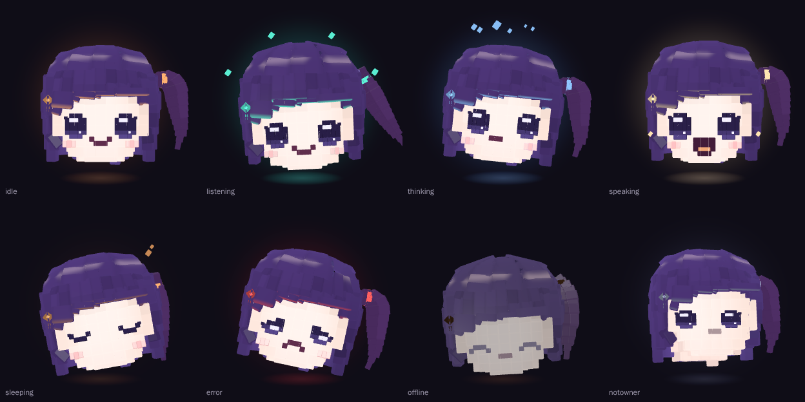
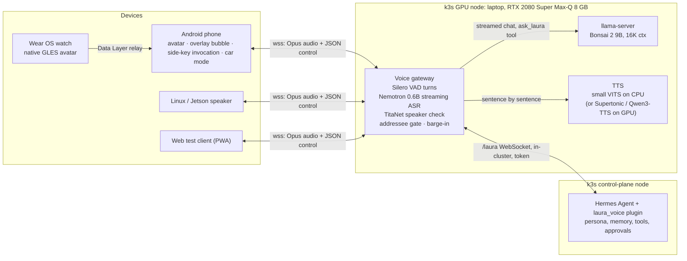
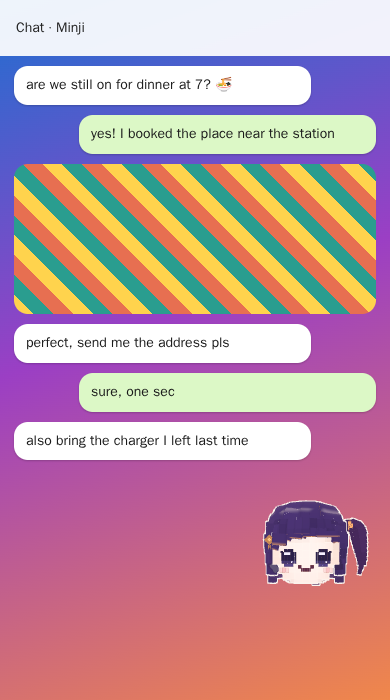
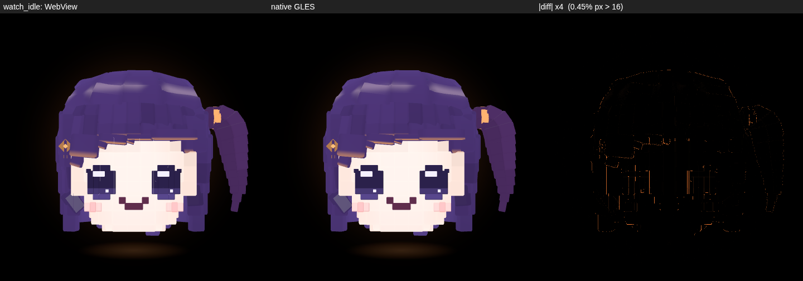

# laura-voice

A private, always-on voice assistant that runs on my own hardware: streaming speech recognition, speaker
verification, a local 9B language model and speech synthesis share one 8 GB laptop GPU in a home Kubernetes cluster,
with Android phone, watch and floating-overlay clients. Live conversation stays local and around a second;
anything that needs tools is handed to my personal agent ([Hermes Agent](https://github.com/NousResearch/hermes-agent))
and comes back as a spoken result.

<p align="center">
  
</p>

## Architecture



One turn: the client's speech gate streams Opus only while someone is talking. The gateway segments turns with
Silero VAD, transcribes them with cache-aware streaming ASR, checks the voice against my enrolled profile, decides
whether the sentence was meant for Laura at all, and streams the transcript to the local model. Replies are
synthesised sentence by sentence while the model is still generating. When a request needs real work (calendar,
homelab, web), the local model calls its one tool, `ask_laura`: Laura says a short acknowledgment, the task runs as
a normal turn in Hermes on a frontier model, and progress, approval prompts and a one-to-three sentence spoken
summary flow back to the phone. Approvals are only ever answered by tapping a button, never by voice.

## Engineering problems and what came out of them

| Problem | What I built | Measured |
|---|---|---|
| Latency on a shared 8 GB GPU | Streaming ASR with an incremental log-mel front end (identical text to NeMo's whole-file streaming buffer), early first clause, sentence-level TTS streaming | End of turn to first reply audio: median 1.12 s, p90 1.5 s over 42 live turns (LLM first clause 0.58 s, TTS 0.42 s) |
| Bilingual streaming ASR | Nemotron 0.6B cache-aware streaming, 100 ms blocks, Korean/English prompt ([server/README.md](server/README.md#streaming-asr-stt)) | FLEURS test (first 100 each, CC BY 4.0): Korean CER 0.076, English WER 0.097; RTF 0.3 on 2 CPU threads |
| Fitting ASR + speaker model + 9B LLM + TTS in 8 GB | NVIDIA device-plugin time-slicing, `Recreate` rollouts, ASR restored on the CPU then moved (restoring onto the GPU peaks at 4.3 GB), per-service memory budget | 6.0 GB idle, 6.3 GB peak with all services resident; budget ~2.9 GB ASR, ~2.4 GB 9B at 16K context, ~0.9 GB GPU TTS |
| TTS fighting the LLM for the GPU | Distilled the Qwen3-TTS voice clone into a single-speaker VITS that runs on 4 CPU threads ([docs/tts-small.md](docs/tts-small.md), weights on [Hugging Face](https://huggingface.co/hectorandac/laura-tts-small)) | 15.7M parameters, RTF ~0.06, ~70 ms to first audio, speaker similarity 0.81 vs the teacher's 0.77, 0 VRAM |
| Answering only me, and only when I talk to her | TitaNet-small verification against a ~30 s enrollment; an addressee gate (name, follow-up window, greeting, else a one-token yes/no from the 9B); "that was for you" recall of skipped turns | Speaker EER 0.6 % clean, 3.5 % on 1.5 s crops (Zeroth-Korean, LibriSpeech, synthetic voices); gate precision 0.82 / recall 0.97 on a 72-item ko/en set, ~90-130 ms |
| Talking over her like over a person | Two-stage barge-in: duck her by 12 dB after ~100 ms of speech, then transcribe the overlap and stop only for a real interruption (not "uh-huh", a cough, the TV or her own echo); the client reports how much it actually played, so "go on" and "repeat that" resume from the right word | Behaviour covered by `server/tests/interrupt_test.py` and `interrupts_unit_test.py` (synthetic echo at -40/-30/-18 dB) |
| Mobile data and battery | Client-side speech gate plus Opus both ways (MediaCodec on Android, WebCodecs in the browser) | ~23 kbps up while speaking, 0 when quiet; ~0.1 MB per question and answer (1.5-2 MB with raw PCM) |
| One avatar on a phone, an overlay bubble and a watch | Voxel avatar in three.js on the phone, ported to native OpenGL ES 3 for the watch and the overlay from an exported parameter model, with a golden-frame parity test | 0.45 % of pixels differ by more than 16 levels (watch idle frame, WebView vs native); watch app 65-85 % of one core while listening and animating |

Other numbers: Bonsai 2 9B (ternary PTQ1_0 weights, PrismML's llama.cpp fork) runs at ~1300 tok/s prompt and ~105 tok/s
generation on the laptop; a handed-off Hermes task takes ~25 s at the median (~7 s
without tools). Details and how each number was measured: [server/README.md](server/README.md),
[clients/README.md](clients/README.md), [docs/hermes.md](docs/hermes.md).

<p align="center">
  
  
</p>

## Repository

| Path | What |
|---|---|
| `server/` | Voice gateway (`assistant_server.py`), streaming ASR (`stt/`), speaker verification, addressee gate, interruptions, Hermes link, TTS services (`tts_small_server.py`, `tts_server.py`, `tts_qwen_server.py`), tests and benchmarks |
| `clients/android/` | Phone app (`:app`), shared engine (`:core`: protocol, speech gate, Opus, routing, transport with certificate pinning), native avatar (`:avatar`) |
| `clients/wear/`, `clients/linux/`, `clients/web/` | Wear OS app, headless Linux/Jetson client, browser test client |
| `hermes/laura_voice/` | Hermes platform plugin: Laura's side of the voice channel |
| `deploy/` | Dockerfiles, Helm chart (GPU pinning, TLS sidecar with a private CA, network policies), VPN watchdog for the GPU node |
| `docs/` | [Protocol](docs/protocol.md), [deployment](docs/deployment.md), [runbook](docs/deploy-runbook.md), [Hermes integration](docs/hermes.md), [deep-questions design](docs/deep-questions.md), [small TTS](docs/tts-small.md), [avatar](docs/avatar/concept.md), [app icon](docs/brand/rationale.md) |

## Running it

You need an NVIDIA GPU with about 7 GB free, a Kubernetes cluster (k3s works) with the NVIDIA device plugin, and
the model files: Nemotron and TitaNet are downloaded by the gateway on first start, the Bonsai GGUF goes in the
host path given by `llm.modelsHostPath`, and the small TTS model
([hectorandac/laura-tts-small](https://huggingface.co/hectorandac/laura-tts-small)) goes in `models/tts-small/` before
its image is built. No weights are in this repository.

```sh
REGISTRY=registry.example.com/laura-voice deploy/build.sh 0.1.0
kubectl create namespace voice
kubectl -n voice create secret generic laura-voice \
  --from-literal=ASSISTANT_KEY="$(openssl rand -hex 16)" --from-literal=LAURA_LINK_TOKEN="$(openssl rand -hex 32)"
helm upgrade --install voice deploy/helm/laura-voice -n voice \
  --set imageRegistry=registry.example.com/laura-voice --set llm.modelsHostPath=/srv/models \
  --set 'tls.certificate.ipAddresses={10.0.0.5}' --set 'llm.allowedNamespaces={hermes}' \
  --set 'gateway.allowedNamespaces={hermes}'
```

Then open `https://<node>:8443/?k=<ASSISTANT_KEY>` on a device that trusts the chart's CA, or build the Android
app (`clients/README.md`). [docs/deployment.md](docs/deployment.md) covers node setup and GPU sharing; each service
also runs as a plain process for development (`server/README.md`). Tests: `pytest` (gateway link, Hermes plugin),
`server/tests/*_test.py` and the evaluation scripts, `./gradlew :core:testDebugUnitTest` for the Android engine.

## Status and limitations

- Built for one person: one conversation at a time, one enrolled voice, Korean and English.
- The phone and watch apps run on a Galaxy S21 (Android 15) and a Galaxy Watch7; the Linux client has not been tried on a real Jetson. The
  clients README keeps a verified-vs-not table.
- Laura's tools, memory and approvals live in Hermes; without the link the local model still talks but can't hand
  work off.
- The ASR benchmark (FLEURS) and the speaker and addressee evaluations use public data or sets in `server/tests/`;
  the TTS quality evaluation used generated data that is not published.
- Qwen3-TTS on the GPU (`tts_qwen_server.py`) works but was rolled back on this Turing card: fp16 overflows and GPU
  contention pushed first audio to several seconds. The deep-questions lane is a design, not implemented yet.
- Certificates come from a private CA because the gateway is reached by VPN IP address.

## License

MIT, see [LICENSE](LICENSE). Third-party code and the models it downloads are under their own licences:
[THIRD_PARTY_NOTICES.md](THIRD_PARTY_NOTICES.md).
